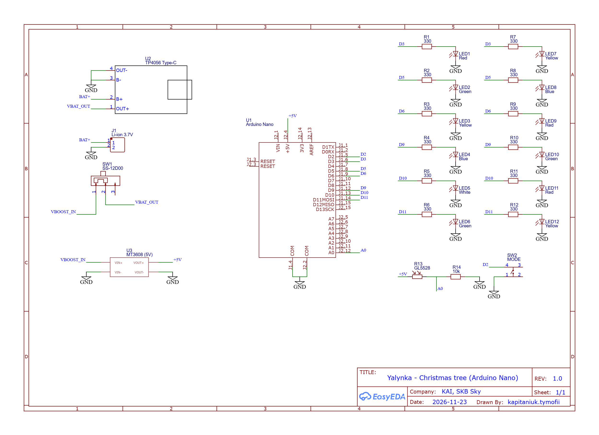

# Ялинка на Arduino Nano

Task01 з курсу «Проєктна робота в СКБ «Sky»» (КАІ, осінь 2026): електрична принципова схема пристрою.

## Схема

## Що робить пристрій

Плата у формі ялинки з 12 кольоровими світлодіодами. Мікроконтролер плавно засвічує і гасить їх через ШІМ. Фоторезистор вимірює освітлення, і від нього залежить, як світиться ялинка. Кнопка перемикає режими. Ялинка живиться від акумулятора Li-ion, а заряджається через USB Type-C.

## Склад

| Позначення | Елемент | Для чого |
|---|---|---|
| U1 | Arduino Nano | керує світлодіодами, читає датчик і кнопку |
| U2 | модуль TP4056 з USB Type-C | заряджає акумулятор і захищає його від перезаряду та глибокого розряду |
| J1 | роз'єм JST-PH 2.0 | підключення акумулятора Li-ion 3,7 В |
| SW1 | перемикач SS-12D00 | вмикає і вимикає живлення |
| U3 | модуль MT3608 | підвищує напругу акумулятора до 5 В |
| LED1–LED12 | світлодіоди 5 мм | гірлянда ялинки |
| R1–R12 | резистори 330 Ом | обмежують струм світлодіодів |
| R13 | фоторезистор GL5528 | датчик освітлення |
| R14 | резистор 10 кОм | разом з R13 утворює дільник напруги |
| SW2 | тактова кнопка 6×6 мм | перемикає режими |

## Підключення до Arduino Nano

| Вивід | Що підключено |
|---|---|
| D3, D5, D6, D9, D10, D11 | ШІМ-виходи, на кожному 2 світлодіоди зі своїми резисторами |
| A0 | середня точка дільника R13–R14 (освітленість) |
| D2 | кнопка SW2 на GND, у прошивці `INPUT_PULLUP` |
| +5V | вихід MT3608 |
| GND | спільний мінус |

Струм через один світлодіод не більше (5 − 2) / 330 ≈ 9 мА. Один вихід дає до 18 мА, це в межах норми для ATmega328P.

## Файли

- `schematic.png` — схема картинкою;
- `schematic.svg` — та сама схема у векторі;
- `Yalynka_EasyEDA_schematic.json` — вихідний файл схеми EasyEDA Standard. Відкрити: EasyEDA → File → Open → EasyEDA Source.

Схему намальовано в EasyEDA Standard.

## Автор

Капітанюк Тимофій, група Б-G5-25-1-EC, КАІ.
